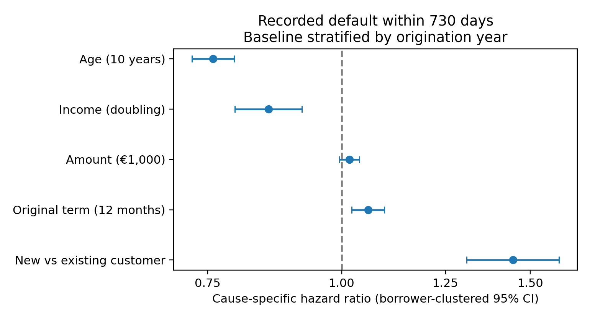

# When Will a Borrower Default?
## A simple survival-analysis example for an MSc lecture

**Question:** Among loans that have not yet defaulted or closed, how does the rate of recorded default vary with borrower and loan characteristics?

**Data:** Estonian Bondora loans issued in 2013–2015. Follow each loan from issue for at most 730 days. The snapshot explicitly reports through 20 July 2021.

| Sample | Count |
| --- | ---: |
| Analyzed loans | 9,844 |
| Borrowers | 6,924 |
| Recorded defaults within 730 days | 2,508 |
| Closure-proxy exits within 730 days | 2,729 |
| Follow-up ending at 730 days | 4,607 |

**One model:** cause-specific Cox regression with age, log income, amount, original scheduled term and new-customer status. Separate baseline hazards by origination year; cluster standard errors by borrower. No model selection, prediction comparison or performance metrics.

| Covariate contrast | Hazard ratio | 95% confidence interval |
| --- | ---: | ---: |
| Age: 10 years older | 0.758 | 0.725–0.793 |
| Income: doubling | 0.854 | 0.795–0.918 |
| Amount: 1,000 recorded monetary units higher | 1.017 | 0.995–1.039 |
| Original scheduled term: 12 months longer | 1.058 | 1.022–1.096 |
| New vs existing customer | 1.445 | 1.308–1.595 |



**Example interpretation:** conditional on the included covariates and origination year, a new customer has an estimated 44% higher instantaneous default rate than an existing customer while their loans remain at risk. This is an association, not a causal effect or a 44 percentage-point increase in default probability.

**Three teaching points:**

1. **Time and outcome definitions come first.** Use DefaultDate even if the loan was later repaid. ContractEndDate is not universally actual repayment: ignore it for Current/Late loans and use it only as a closure proxy for Repaid loans. The exact default arrears threshold is unverified.
2. **A hazard ratio is a summary with assumptions.** Age shows nonlinearity and evidence against proportional hazards; new-customer status also shows a PH departure in the full sample. The corrected diagnostic does not reproduce a PH departure for original term. Explain these caveats without adding a more complex lecture model.
3. **Repeated loans are not independent observations.** Use borrower-clustered intervals. Keeping one analyzed loan per borrower gives broadly similar coefficient directions, although the sample becomes predominantly new customers and some associations attenuate.

Original term is reconstructed from the original monthly payment schedule, not revised maturity. Removing 59 disputed term records or ten ambiguous closure-censored records barely changes the main coefficients. These checks and source-definition limitations are documented in [REPORT.md](REPORT.md); they can remain backup material.

## Minimal model code

After the documented date audit and cohort construction:

```python
from lifelines import CoxPHFitter

# df has one row per loan. duration and event use the audited definitions.
columns = ["duration", "event", "year", "UserName",
           "age_10y", "log_income", "amount_1000", "term_12m", "new_customer"]

model = CoxPHFitter()
model.fit(df[columns], duration_col="duration", event_col="event",
          strata=["year"], cluster_col="UserName", robust=True)
model.print_summary()
```

The income coefficient in this code is per natural-log unit; multiply the coefficient and its standard error by ln(2) to display the doubling contrast in the table. See [README.md](README.md) for the full reproducible run. The analysis uses recorded monetary values; confirm original currency/period definitions before making literal euro/month claims. All intervals are approximate with tied daily event times. No slides have been created.
