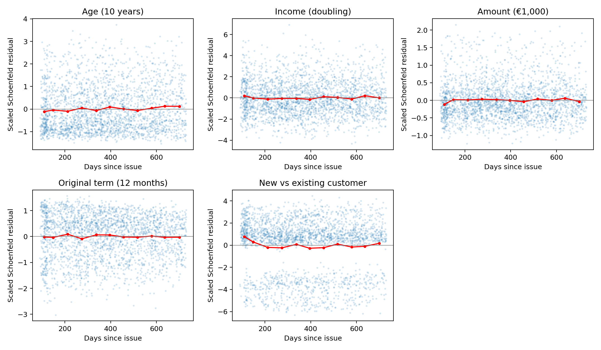

# When Will a Borrower Default? Survival Analysis in Credit Risk

## Analysis finding

In 9,844 Estonian loans originated in 2013–2015, 2,508 first recorded defaults occur within 730 days. Older age and higher income are associated with lower conditional default hazards; new-customer status and longer original scheduled terms are associated with higher hazards. The amount estimate is close to one and its interval includes one. These are explanatory associations, with important qualifications: age shows both PH and functional-form departures, and new-customer status shows a PH departure in the repeated-loan analysis. **The previously suggested original-term PH departure is not reproduced after correcting the rank-time diagnostic for the stratified fit.** This is not a claim that PH has been proved.

No slides, predictive comparisons or performance claims have been made. All numerical results below come from the uploaded data, not the earlier synthetic smoke test.

## 1. Source and definition audit

The uploaded filtered dataset has **9,863 rows, 112 columns and 6,938 unique borrower usernames**, with no duplicate LoanId. Every row has `Country=EE` and LoanDate in 2013–2015. It was supplied after the user filtered the original [Kaggle snapshot](https://www.kaggle.com/datasets/sid321axn/bondora-peer-to-peer-lending-loan-data). Completeness relative to the original full CSV cannot be checked from this subset.

**Reporting cutoff is 20 July 2021**, explicitly recorded in every `ReportAsOfEOD`. It is not inferred from the latest default, last payment or Kaggle upload date. Even the latest origination has completed 730 calendar days by this cutoff. Defaults after 730 days are not events for this analysis. All audited nonmissing date strings parse successfully, and no DefaultDate, ContractEndDate or LastPaymentOn precedes origination.

**Default means first recorded DefaultDate**, not snapshot Status=Late, loss, write-off or any late payment. There are 3,778 recorded default dates in the input, including 1,866 loans currently labeled Repaid and six currently labeled Current. An earlier default remains an event even if repayment later occurs. Bondora's original business dictionary could not be retrieved under the network policy, so the exact arrears-day threshold is unverified and no 60-/90-day definition is asserted.

**ContractEndDate is not universally an actual repayment date.** It is present on 307 Current loans (all beyond reporting cutoff) and 584 Late loans (470 beyond cutoff). Its maximum is 27 May 2027. Across statuses it equals original maturity on 1,703 loans, so scheduled and realized date meanings cannot be assumed interchangeable.

There are 7,612 Repaid loans, of which 7,598 have ContractEndDate. All have nonpositive principal balance, but 1,001 have positive principal write-offs and 1,034 have recorded principal payments below original amount (tolerance €0.02). ContractEndDate equals LastPaymentOn for 6,051 Repaid loans; agreement does not by itself establish the date of full cash repayment. Therefore the main nondefault exit is explicitly a **recorded closure proxy: ContractEndDate conditional on Status=Repaid**, not guaranteed full repayment. Raw ContractEndDate for Current/Late loans is ignored. LastPaymentOn is not generally substituted for full repayment. The stricter sensitivity described below corroborates the actual closure-censored subset.

**Original contractual term is reconstructed**, assuming monthly original installments, as inclusive calendar months from FirstPaymentDate to MaturityDate_Original. First payment is 17–69 days after origination in all rows. This schedule-derived term is 1–60 months and agrees with LoanDuration for 9,804/9,863 loans; 59 disagree. LoanDuration is not automatically treated as immutable original term, and MaturityDate_Last is never used as a baseline covariate. A sensitivity excludes the disagreements. The monthly-schedule interpretation remains a proxy without original contract histories.

IncomeTotal equals the sum of the available income components exactly in every row. Amount/income are used as recorded monetary fields for this Estonia-only cohort; original source currency, income-period and origination-time measurement definitions could not be independently verified. Euro/month interpretation is conventional for this snapshot but not established by the numeric fields alone. NewCreditCustomer is the recorded origination indicator, not reconstructed from later loan counts: 268 True rows have a positive reported previous-loan count and 55 False rows have zero, so these definitions are not interchangeable.

## 2. Cohort and endpoints

Time zero is LoanDate. Stop at the earliest recorded default, qualified closure proxy, 730 days, or reporting cutoff. Default on the endpoint boundary is included. Closure is a competing exit represented as censoring in a cause-specific Cox fit; this targets the default rate while a loan remains exposed, not a hypothetical world without repayment or a cumulative default probability.

From 9,863 rows, exclude 14 Repaid loans with missing closure dates, three same-day default/closure conflicts whose within-day order is unknown, and two nonpositive-income loans because log income is undefined. No other invalid/missing model covariates or zero-day exits remain. Of the three date ties, only one lies within 730 days; the same conservative exclusion applies to all. These exclusions are explicit rather than inferred clean outcomes.

| Measure | All | 2013 | 2014 | 2015 |
| --- | --- | --- | --- | --- |
| Loans | 9,844 | 2,279 | 4,138 | 3,427 |
| Unique borrowers¹ | 6,924 | 1,983 | 3,624 | 2,688 |
| Recorded defaults ≤730 days | 2,508 | 476 | 1,086 | 946 |
| Closure-proxy exits | 2,729 | 677 | 1,227 | 825 |
| 730-day administrative exits | 4,607 | 1,126 | 1,825 | 1,656 |

¹Borrowers can appear in multiple years, so vintage borrower counts do not sum to the overall count. Overall, 2,019 borrowers have multiple analyzed loans. Follow-up totals 14,254.4 loan-years; 69.47% of analyzed loans are marked new-customer. The 25.48% observed event fraction is a sample count, not a Cox-estimated or counterfactual default probability. All 4,607 administrative exits occur at 730 days, not the later reporting cutoff.

| Measure | Overall median [IQR] |
| --- | --- |
| Age, years | 35.00 [28.00, 44.00] |
| IncomeTotal, recorded currency units | 830.00 [619.00, 1149.25] |
| Amount, recorded currency units | 2000.00 [1000.00, 3190.00] |
| Original scheduled term, months | 48.00 [24.00, 60.00] |
| Observed follow-up, days | 662.00 [330.00, 730.00] |

## 3. Single primary model

Cause-specific Cox regression includes age/10, ln(IncomeTotal), Amount/1000, original scheduled term/12, and NewCreditCustomer. Baseline hazards are separately estimated by origination year; regression coefficients are shared across years. Borrower-clustered sandwich standard errors account for repeated loans. Confidence intervals are unadjusted 95% Wald intervals. The income coefficient is rescaled by ln(2) for a doubling contrast.

| Contrast | Primary HR (95% CI) | One loan/borrower HR (95% CI) |
| --- | --- | --- |
| Age (10 years) | 0.758 (0.725–0.793) | 0.760 (0.727–0.795) |
| Income (doubling) | 0.854 (0.795–0.918) | 0.900 (0.835–0.970) |
| Amount (€1,000) | 1.017 (0.995–1.039) | 1.000 (0.976–1.025) |
| Original term (12 months) | 1.058 (1.022–1.096) | 1.040 (1.001–1.080) |
| New vs existing customer | 1.445 (1.308–1.595) | 1.544 (1.186–2.009) |

The primary age HR of 0.758 is about a 24% lower modeled instantaneous default rate per ten years, conditional on the other included covariates and vintage. It is neither a 24 percentage-point probability reduction nor a constant effect established across all ages/times. The PH/linearity checks below limit that interpretation. No covariate is randomized; lending selection, unobserved borrower circumstances and calendar conditions can confound these associations.

## 4. Proportional hazards and functional form

Approximate Schoenfeld tests use an auxiliary fit of the **same model** with independence-based variance. Their full-cohort p-values are exploratory and are **not cluster-adjusted PH tests**. Elapsed-rank uses the pooled empirical rank of elapsed event times, preserving equal ranks for tied days. Log-time is a prespecified complementary transform. The one-loan sample removes within-borrower repetition but changes sample composition. No global cluster-adjusted test is claimed.

| Covariate | PH: elapsed-rank p | PH: log-time p | One-loan PH: elapsed-rank p |
| --- | --- | --- | --- |
| Age (10 years) | 0.00641 | 0.00768 | 0.0462 |
| Income (doubling) | 0.933 | 0.621 | 0.347 |
| Amount (€1,000) | 0.236 | 0.118 | 0.0881 |
| Original term (12 months) | 0.777 | 0.997 | 0.356 |
| New vs existing customer | 0.00888 | 0.000417 | 0.675 |

Age departures appear with both transforms in the main analysis; the one-loan elapsed-rank result is borderline (p≈0.046), while its log-time result is p≈0.057. The residual trend suggests the age association is less protective later, but these plots do not estimate a time-specific causal effect. New-customer status has main-sample departures under both transforms; these are not reproduced in the one-loan sample. Original term has no detected PH departure under either corrected transform in either sample.

**Rank-order trap:** lifelines' built-in rank transform cumulatively counts events in fit-row order. With year-stratified fits that order is year then time, so it is not a global elapsed-time rank. In this dataset the built-in calculation yields a misleading original-term p≈0.013; corrected elapsed-rank p≈0.777 and log-time p≈0.997. The corrected implementation passes a vintage-label-reversal invariance check. This demonstrates a possible source of spurious term departures; it does not establish how earlier exploratory results were produced. The naive output is retained as `ph_builtin_rank_NOT_FOR_INFERENCE.csv` and is not used for conclusions.

Functional-form checks add restricted cubic spline nonlinear terms for one continuous covariate at a time, holding the other primary covariates fixed. Two nonlinear terms are jointly tested using the borrower-clustered sandwich; this checks departures from log-linear effects, not whether a covariate has any association. Four knots and their discrete-support fallback are saved in the CSVs.

| Covariate | Nonlinearity p | One-loan nonlinearity p |
| --- | --- | --- |
| Age (10 years) | 0.00358 | 0.0313 |
| Income (doubling) | 0.185 | 0.258 |
| Amount (€1,000) | 0.805 | 0.667 |
| Original term (12 months) | 0.0438 | 0.101 |

Age has evidence of nonlinearity in both cohorts. Original term has a borderline nonlinear departure in the primary cohort, not reproduced at 0.05 in the one-loan cohort; knot choice and discrete support matter. Income and amount show no detected nonlinear departures under these specific checks. Failure to reject is not proof of linearity. PH and nonlinearity are distinct assumptions, and functional-form misspecification can affect PH diagnostics. These multiple exploratory p-values have no multiplicity correction. Keep the requested single Cox model, but present its HRs as compressed summaries where assumptions are doubtful.

## 5. Robustness and independent verification

**One loan per borrower:** choose the earliest analyzable loan, breaking same-day ties by LoanId. This gives 6,924 loans, 1,842 defaults and no repeated borrower. Age remains similar, income attenuates toward one, term attenuates modestly, and amount stays near one. New-customer intervals widen because 95.05% of this sample is new-customer, compared with 69.47% in the primary sample. It is a different selected sample, not an independent replication or proof against confounding.

**Closure sensitivity:** among 2,729 closure-proxy exits within 730 days, 2,719 have principal payments covering amount within €0.02, absolute principal balance ≤€0.02, write-offs ≤€0.01 and ContractEndDate=LastPaymentOn. Exclude the ten uncorroborated closure-censored loans while retaining all observed defaults: 9,834 loans and 2,508 defaults remain, with materially unchanged HRs. This supports numerical stability of the chosen proxy, not its universal business validity.

**Original-term sensitivity:** exclude all 59 schedule/LoanDuration disagreements. The remaining 9,785 loans have 2,489 defaults; HRs remain similar (age 0.755, income doubling 0.853, amount 1.019, term 1.058, new customer 1.443). This supports stability to the disputed term records, while retaining the monthly-schedule assumption.

Independent endpoint reconstruction agrees exactly on loan membership, durations, event indicators and original scheduled terms. The same stratified Efron Cox coefficients computed with statsmodels PHReg differ from lifelines by at most 1.6e-06, below the 1e-5 tolerance. This is a coefficient-only implementation check; independent cluster-SE verification is not claimed. Boundary/selection tests and a complete rerun of the saved reproduction command pass. No convergence warnings occurred; captured diagnostic warnings concern a lifelines UTC deprecation.

Daily dates create tied events. Lifelines' cluster sandwich has documented limitations with many ties, so its intervals and the spline Wald tests are approximate. Do not jitter outcome dates to remove ties. Borrower clustering, baseline stratification and these sensitivities do not repair unmeasured confounding or uncertain source definitions.

## 6. Reproduction and files

Follow [README.md](README.md) and run `bash analysis/reproduce.sh` in the pinned Python environment. It executes scientific endpoint tests, the real-data analysis, independent verification and this report renderer. All tables, plots, audit counts, attrition, recorded warnings and sensitivity outputs are in `results/`. [CSV estimates](results/hazard_ratios.csv), [sample summary](results/sample_summary.csv), [PH checks](results/ph_schoenfeld_independence.csv), [functional-form checks](results/functional_form_cluster_wald.csv), [HR plot SVG](results/hazard_ratios.svg).

Input SHA-256: `52e847936a33fb3f9ab7a0901f662a624ed747a9c4c081f490dd0c1f3786798a`.

Sources: the user-specified Kaggle snapshot and its accessible API metadata/description (saved in `sources/`); the uploaded recorded field values; lifelines 0.30.0 and statsmodels 0.14.6. Bondora's linked [PublicDatasetItem dictionary](https://api.bondora.com/doc/ResourceModel?modelName=PublicDatasetItem&v=1) was inaccessible through this environment. Confirm its historical definitions before presenting a specific arrears threshold, literal full-repayment timing, or definitively original income/term measurement. The calculations are complete for the operational definitions above; these remaining source-definition limitations are explicit, not silently assumed resolved.
