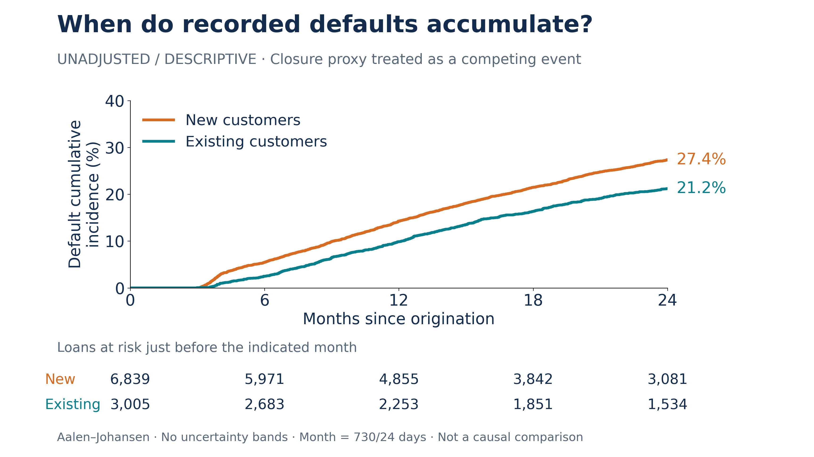

# Descriptive timing of recorded default

The **unchanged audited cohort** has 9,844 loans: 2,508 default exits, 2,729 qualified closure-proxy exits and 4,607 administrative exits. The new-customer group has 6,839 loans; the existing-customer group has 3,005. These are loan-level curves; repeated borrowers remain present and may appear in both groups across loans.



## Outputs

- `default_cif.pdf`, `.svg`, `.png`: vector and high-resolution presentation-ready exports, with a compact risk table.
- `horizon_estimates.csv`: default/closure cumulative incidence and remaining event-free probability at 6, 12 and 24 months, by customer status and overall; starting denominators and event counts are included.
- `curves.csv`: the complete event-time recursion, all three probabilities, pre-time risk counts and tied-cause/censoring counts.
- `numbers_at_risk.csv`: risk counts immediately before 0, 6, 12, 18 and 24 plotted months.
- `cohort_counts.csv`: cause counts and sample sizes by customer status and overall.
- `validation.json`: input/protected-file hashes, reconciliation, endpoint, tie, monotonicity and probability-mass checks.
- `summary.md`: the report section also embedded in the root analysis report and lecture summary.

## Estimator and time convention

Run from the repository root in the existing pinned Python environment:

```sh
python analysis/cumulative_incidence.py
```

The exact user-supplied input is `data/Bondora_Estonia_2013_2015.csv.gz`; it must match the original audit's recorded SHA-256. It is not published here. The script calls the existing `audit`/`cohort` construction into a temporary directory and checks the saved attrition/conflict records and every vintage's counts. It does not call the Cox-fitting function or alter the original result tables.

Deterministic Aalen–Johansen: aggregate all tied daily defaults and closures, use the same pre-time risk set and event-free probability for both cause increments, then remove same-day administrative censoring. **No jitter.** The algorithm includes events at day 730 before administrative censoring that day. Three recorded defaults and five closures occur exactly on day 730, so the pre-day-730 risk count is 4,615, not the 4,607 loans administratively censored afterward. Same-day default/closure conflicts within an individual loan remain excluded under the existing audit; ties between different loans are retained.

One plotted month = 730/24 days. Thus the 6-, 12-, and 24-month estimates include events at/before 182.5, 365 and 730 days respectively. With integer daily dates, 6 months includes days through 182; the risk table at 182.5 days counts remaining loans from day 183 onward. The table is **just before** each grid time, while the CIF is **after** any event exactly at that grid time. Calendar months are not used.

All administrative censoring is at 730 days. Independent direct event fractions therefore equal the AJ default CIF at each event time and each displayed horizon (maximum absolute error ≈2.1×10⁻¹⁵). Default CIF + closure CIF + event-free probability equals one. Both cause CIFs start at zero, stay within [0,1] and are nondecreasing. Synthetic tied-event and early-censoring examples independently check the algorithm, including the terminal boundary.

## Interpretation

At 24 months, the descriptive default CIF is **27.36% new vs 21.20% existing**; at 12 months it is **14.29% vs 9.88%**. The graph accounts for the audited closure proxy as a competing event, not as ordinary censoring in 1−KM. It is unadjusted and descriptive, not a validated individual forecast or a causal comparison. Customer groups differ in other covariates and vintage composition. No confidence bands or independence-based inferential claims are supplied; repeated borrowers would require appropriate uncertainty handling.

The audited Cox HR for new-customer status remains **1.445 (approximate borrower-clustered 95% CI 1.308–1.595)**. It is an adjusted relative default rate among exposed loans, not a ratio of the graph's cumulative proportions. The existing PH and measurement qualifications remain in the report and presentation notes. The closure proxy is not guaranteed full repayment, and the source default threshold remains unverified.
